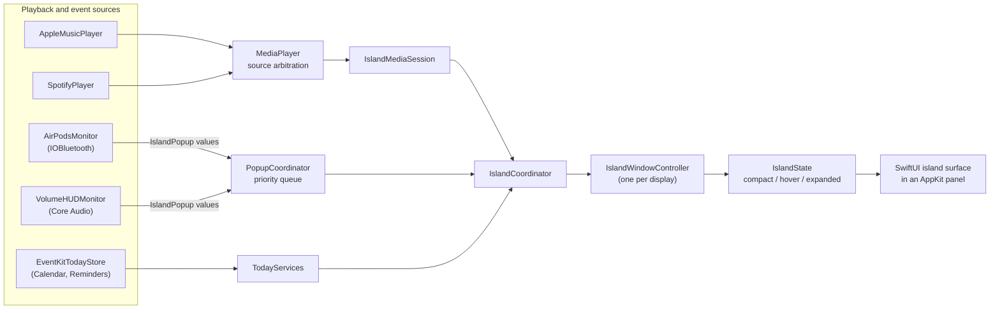

# Architecture

Minnow is a single SwiftPM executable target (`MacDynamicBar`) of roughly 9,800 lines of Swift, plus about 1,900
lines of tests, organised into feature modules under `Sources/MacDynamicBar/`. The app is built on three ideas:

1. **Event sources never own UI.** Monitors emit small value types; one coordinator decides what is shown.
2. **Policies are pure value types** with injected clocks, so the interesting logic is unit-testable without
   hardware.
3. **Unverified capabilities are explicit.** Where a signal cannot be read reliably, the app shows an
   unavailable state instead of guessing.

## System overview

`IslandCoordinator` is the composition root. It owns the media session, the popup coordinator, the Shelf store,
the monitors and one `IslandWindowController` per display. Display, sleep/wake, session and fullscreen changes
are handled there, so individual features do not need to know about them.

## Modules

| Module | Responsibility |
|---|---|
| `App/` | Entry point, menu bar item, launch options |
| `Island/` | Panel and hosting view, layout and geometry, shape and material, presentation state, display coordination, fullscreen visibility |
| `Media/` | Apple Music and Spotify playback, scrubbing, artwork, output selection, audio-level capture, optional Spotify account link |
| `Events/` | `IslandPopup` value type and the `PopupCoordinator` queue |
| `AirPods/` | Bluetooth connection monitoring, identity recognition, duplicate suppression |
| `Battery/` | IOKit power-source readings and the threshold alert policy |
| `SystemHUD/` | Volume (Core Audio) and experimental brightness feedback |
| `Today/` | EventKit calendar and reminder snapshots, selection, completion |
| `Shelf/` | Drag-and-drop file shelf with security-scoped bookmarks |
| `LockScreen/`, `MusicScene/`, `Widgets/` | Experimental lock-screen player, synced lyrics, widget strip |
| `Settings/` | Persisted preferences and the native settings interface |
| `Integrations/` | Experimental, user-triggered integration diagnostics |

## Design decisions

### Popup queue: serialise, prioritise, expire

All temporary events pass through `PopupCoordinator`, which keeps music playback and the compact surface
untouched while a popup is shown.

- **Priority ordering.** The queue is sorted by priority, then by creation time. Priorities are defined once on
  `IslandPopup` (for example, a low-battery alert outranks a charging notice, which outranks an AirPods
  connection).
- **Bounded.** At most 8 pending popups are kept.
- **Expiry.** Each popup has a lifetime; stale events are dropped at submit time and again before presentation,
  so a delayed event never appears long after the fact.
- **Deduplication.** A popup key seen in the last 10 seconds is ignored, except for HUD updates, which replace
  the one on screen.
- **Preemption without replay.** A higher-priority popup replaces the active one, and the superseded popup is
  dropped rather than replayed afterwards.
- **Interaction-aware.** While the user is scrubbing, using the output picker, completing a reminder or dragging
  onto the Shelf, the coordinator is marked busy and presentation is deferred.

### Presentation state machine

`IslandState` models the surface as `compact`, `hover` and `expanded`, with a separate pinned (click) state.
Leaving the surface schedules a short debounced exit, and that exit is cancelled or suppressed while any
interaction is in progress. One window controller is created per connected display, and all displays share a
single playback and audio-capture session.

### Isolating AppleScript

Apple Music and Spotify are controlled through AppleScript, which blocks. `PlaybackScriptWorker` runs every
script on one serial queue and exposes an `async` interface, with a shutdown flag so no script starts after the
app begins stopping. Both players implement a common `DesktopPlayback` protocol, and `MediaPlayer` arbitrates
between them (Auto follows the most recently started player; Music and Spotify pin a source).

### Policies as value types

- `BatteryAlertPolicy` raises the 20% and 10% thresholds once per discharge cycle, resets on external power, and
  emits only the more urgent alert if both thresholds are crossed at once. macOS already shows its own low-battery
  and charging alerts, so the app currently uses battery readings only for the lock-screen and music-scene
  battery widget. The policy is retained and covered by tests, but it is not wired to the popup queue.
- `AirPodsConnectionPolicy` seeds already-connected devices silently at launch and wake, ignores duplicate
  callbacks, and suppresses reconnect storms.
- `BluetoothOutputNaming` matches audio-route identifiers to paired-device addresses and prefers the user's
  personalised device name over a generic model label.

Each takes its inputs as parameters (including the clock), which is what makes them straightforward to test.

### Honest capability handling

- Explicit-content badges are shown only when the Spotify API track matches the desktop track, never guessed.
- AirPods battery percentages are not shown, because no verified public source is used.
- The "hide from screen capture" and "EQ" controls are shown as unavailable, with the reason.
- Experimental features are opt-in or user-triggered: the lock-screen player, online lyrics and brightness
  feedback are off by default, and the phone-call integration is a diagnostic you run explicitly.

### Concurrency

UI state is `@MainActor`. Network access uses an `actor` (`LRCLIBClient`). The package builds with the Swift 6
toolchain and enables the `ApproachableConcurrency` upcoming feature.

## Testing

Tests use Swift Testing (`Tests/MacDynamicBarTests/`, 14 files). They cover layout and geometry, the hover and
pinning state machine (including delayed exit during scrubbing), persisted preferences and layout migration,
seek clamping and invalid input, Spotify URI encoding and stale-track handling, the popup queue and event
policies, Bluetooth naming, Shelf persistence, Today snapshots, and offscreen rendering of popup views. A slower
scene-render test is opt-in; see [DEVELOPMENT.md](DEVELOPMENT.md).

Behaviour that depends on hardware or system permissions (lock screen, real AirPods connections, fullscreen
Spaces, output switching) cannot be fully covered by automated tests and is verified manually.
